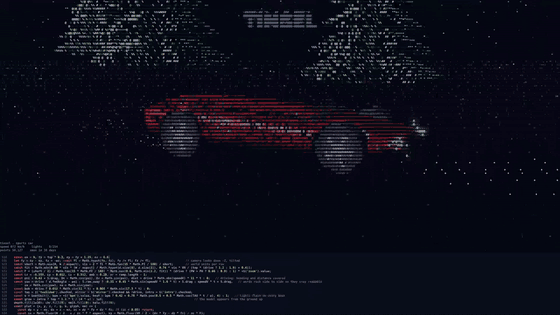

# tinsel

Wrap a car in Christmas lights and render it as ASCII. Or a tree, a rocket, a word, or any 3D model you drop in.
It runs entirely in the browser: one HTML file, no build step, no server, nothing uploaded.

**Try it:** https://wrapinlights.com

## What you can do

- Pick a shape: any word, your own photo (it never leaves your device), a snow globe with your place or name, a house with lit windows and chimney smoke, five car body styles, a steam train, a jet, a sleigh, tree, rocket, snowman, gift, or your own `.glb` / `.obj` / `.stl`
- Lights that follow the model's edges (roofline, sills, wheel arches), or a wrapped string, or scattered bulbs
- Three scenes: driving through snow (ground, snowfall and pines slide past, wheels turn), flying through snow, or spinning on ice with a reflection
- A build-up intro, a caption, and the page's own source code scrolling underneath
- Lights that pulse to a tempo you choose, so the video lands on the beat of whatever song you add when you post it
- Sound in the video: three old carols (Jingle Bells, Deck the Halls, Carol of the Bells) played by the page itself and recorded into the download, with the lights in time
- Or time the lights to a pop song and preview it through Spotify's own small player; nothing is copied onto the site, that video stays silent, and you add the song in Instagram or TikTok when you post
- On a phone, one button opens the share sheet to save the video or post it
- Download an MP4 (vertical, square or wide), or send a link that replays exactly what you made

## Host it on Vercel

This repository deploys as it is: no framework, no build step.

1. Push it to GitHub.
2. On vercel.com choose Add New > Project, import the repository, leave the framework preset on "Other", and deploy.
3. In the project, open Analytics and enable Web Analytics. The page already reports visits and share events to it.
4. If you fork this, change the address in `const SITE`, `og:image` and `og:url` in `index.html` to your own.

Every later push redeploys automatically. Without GitHub, `npx vercel --prod` from this folder does the same thing.
`vercel.json` only sets two headers, and `.vercelignore` keeps the Python folder and docs out of the deployment.

To try it locally: `python3 -m http.server 8000`, then open http://localhost:8000.

`const SITE` near the top of the script is the address stamped on every video. On a custom domain the page uses that domain instead.

## How it spreads

"Send it as a link" produces a link that opens full screen, plays the animation, and then offers a "Make your own" button.
Links carry only settings, so they work for every built-in shape but not for uploaded models (share the video for those).
Every video carries the site name at the top of the frame.

To see whether people actually share, look at the events the site reports to Vercel Web Analytics (and to Plausible or Umami if you add either):
`card_view`, `make_own`, `link_made`, `video_made`, `model_upload`.

## Using your own models

`.glb` files keep their material colours and textures; `.obj` keeps colours if you select the `.mtl` with it; `.stl` is one colour.
Geometry nobody can see is thrown away so the visible shell gets the detail. Draco or Meshopt compressed `.glb` files are not supported.

Check the licence of every model before you post a video of it. CC0 needs nothing, CC-BY needs a credit in your caption,
and "editorial" or "non-commercial" licences are not safe for a monetised account. Every built-in shape is generated by code in the page.

## How it works

Everything is a cloud of points with normals. Each frame: rotate, project with perspective, keep the nearest point per character cell,
shade it, and pick a character by brightness. Lights are extra points that ignore shading and tint their neighbours.
Uploaded meshes are sampled into points; sharp folds and open edges are found by welding vertices and comparing neighbouring faces.
Characters are painted straight into the canvas pixels from a small glyph atlas, and the canvas is recorded with MediaRecorder.

## Python version

`python/` holds the original prototype: the same renderer in NumPy with a live terminal player and frame-exact MP4 export.
It is behind the site (no edge lights, no `.glb`). See `python/README.md`.

## Known gaps

- Tested in Chrome on desktop only. Safari, Firefox and phones are untested; recording on phones may not work.
- Recording is real time, so a slow machine drops frames. The page lowers its point count automatically when frames get slow.
- Uploaded cars do not spin their wheels in the driving scene.

## Licence

MIT. See `LICENSE`.
